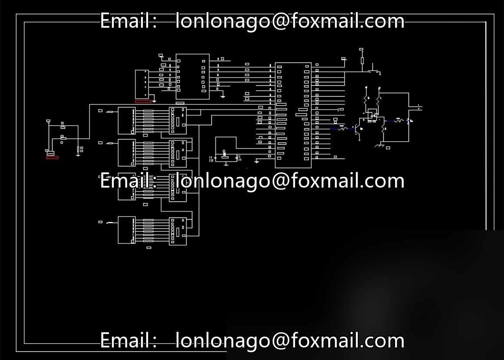
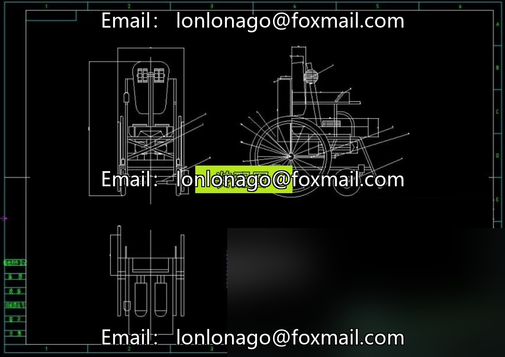

# Self-rolling wheelchair design; self-rolling wheelchair design drawings; self-rolling wheelchair design CAD drawings; self-rolling wheelchair design CAD diagrams; self-rolling wheelchair design CAD drawings

## Body

Automatic wheelchair design; automatic wheelchair design drawing; automatic wheelchair design CAD drawing; automatic wheelchair design two-dimensional drawing. This design provides design methods for software and hardware structure and unit circuit, parameter selection, and analysis of actuator principle; gives formula calculation method for synthesizing wheelchair speed and movement direction information, as well as S-curve generation strategy for improving running comfort. 328

The design provides self-rolling wheelchair design diagrams and CAD figures, including two-dimensional drawings, as well as software and hardware structural designs, unit circuit designs, parameter selection methods, operating lever working principle, velocity and direction information synthesis formulas, and an S-curve generation strategy for running comfort.

<!-- AI_ENRICHED -->

## Images

## Payment

Here is a pay link on Stripe ( https://buy.stripe.com/3cs8yP7sY87d0vu9AB ). Please contact me lonlonago@foxmail.com after funding $89, and I will send you a complete data files , thank you!

